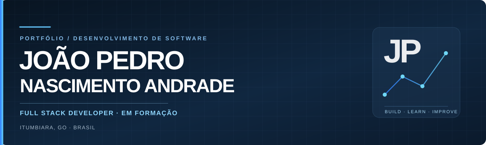

  

  <a href="https://www.linkedin.com/in/joao-pedro-nasciment0/">LinkedIn</a>
  &nbsp;&nbsp;·&nbsp;&nbsp;
  <a href="mailto:joaop06nascimento@gmail.com">E-mail</a>
  &nbsp;&nbsp;·&nbsp;&nbsp;
  <a href="https://github.com/jpedronasc">GitHub</a>

## Olá, sou o João Pedro.

Sou estudante do **Ensino Médio Técnico em Desenvolvimento de Sistemas (SESI/SENAI)** e estou em busca da minha primeira oportunidade de **estágio em desenvolvimento Full Stack**.

Gosto de transformar problemas reais em soluções simples. Minha experiência com rotinas administrativas me trouxe organização, atenção aos detalhes e visão de processos — habilidades que hoje aplico ao estudar e desenvolver aplicações web.

Atualmente aprofundo meus conhecimentos de front-end, back-end e bancos de dados, buscando evoluir em boas práticas de desenvolvimento.

### Tecnologias e ferramentas

**Desenvolvimento web**

**Dados e ferramentas de apoio**

### Experiência

| Período | Atuação | O que desenvolvi |
| :-- | :-- | :-- |
| **Nov/2026 – atual** | **Bora na Tech** · Criador de Conteúdo e Afiliado | Comunicação sobre tecnologia, produção de conteúdo e divulgação de ferramentas e oportunidades. |
| **Mai/2025 – Jun/2026** | **bp bioenergy** · Aprendiz Administrativo | Organização de informações, planilhas, apoio a processos internos e comunicação entre setores. |

### Formação

**Técnico em Desenvolvimento de Sistemas — SESI/SENAI**  
Jan/2024 – Dez/2026 · Ensino Médio Técnico

**Curso de Inglês — Senac / SESC**  
Fev/2018 – Jun/2025

**Cursos e certificações**

- Introdução à Programação com JavaScript
- Fundamentos da Criação de Sites com HTML e CSS
- Lógica de Programação
- Tecnologia da Informação e Comunicação (TIC)
- Design de Interfaces Web (UX/UI)

### Em que estou focado

- Construir aplicações web completas, do front-end ao banco de dados.
- Evoluir em lógica de programação, desenvolvimento e organização de código.
- Participar de projetos reais e conquistar minha primeira oportunidade em desenvolvimento Full Stack.

---

  <strong>Vamos conversar?</strong> 
  Estou aberto a oportunidades de estágio, projetos e conexões na área de tecnologia.  
  <a href="mailto:joaop06nascimento@gmail.com">joaop06nascimento@gmail.com</a>
  &nbsp;·&nbsp;
  <a href="https://www.linkedin.com/in/joao-pedro-nasciment0/">LinkedIn</a>  
  Itumbiara, Goiás · Brasil

